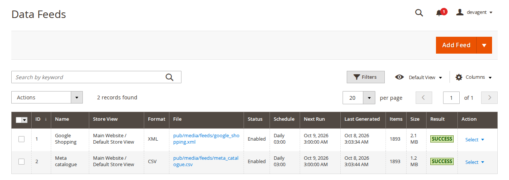
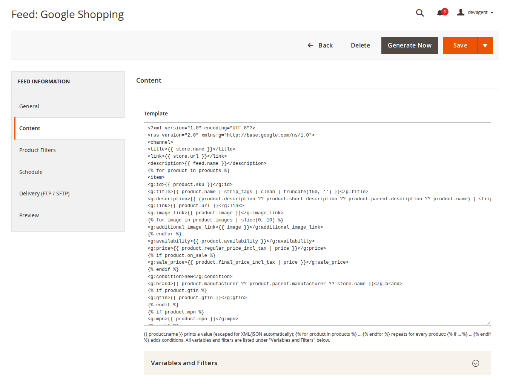
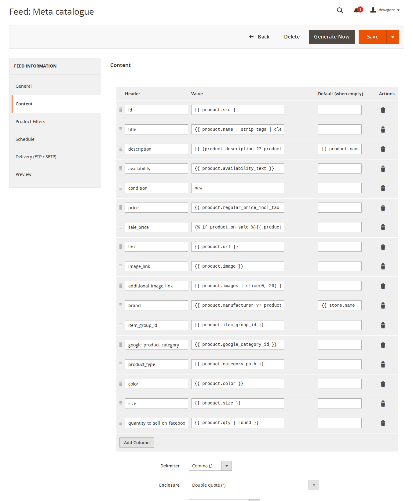
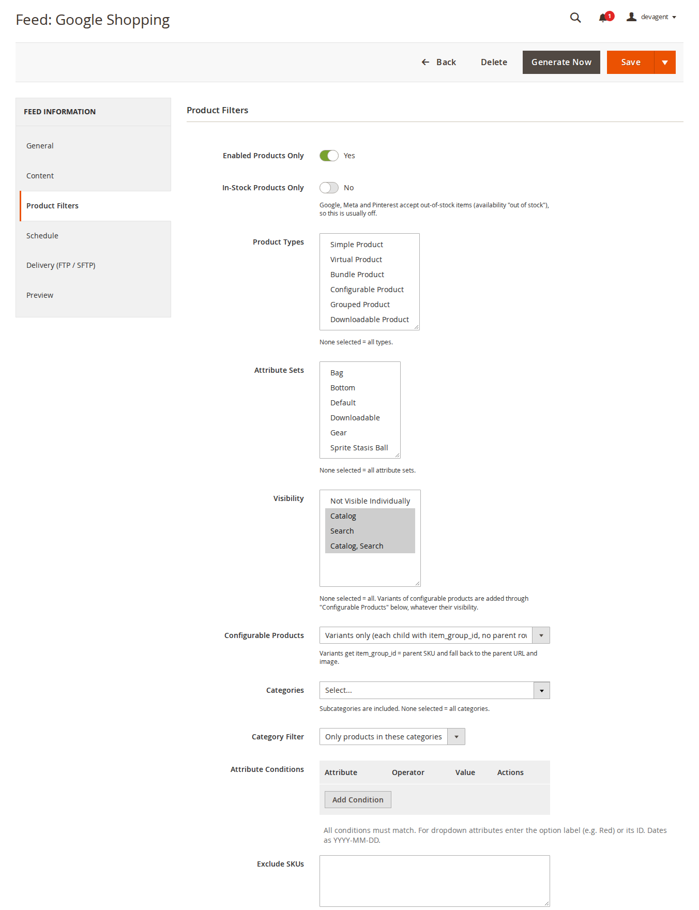
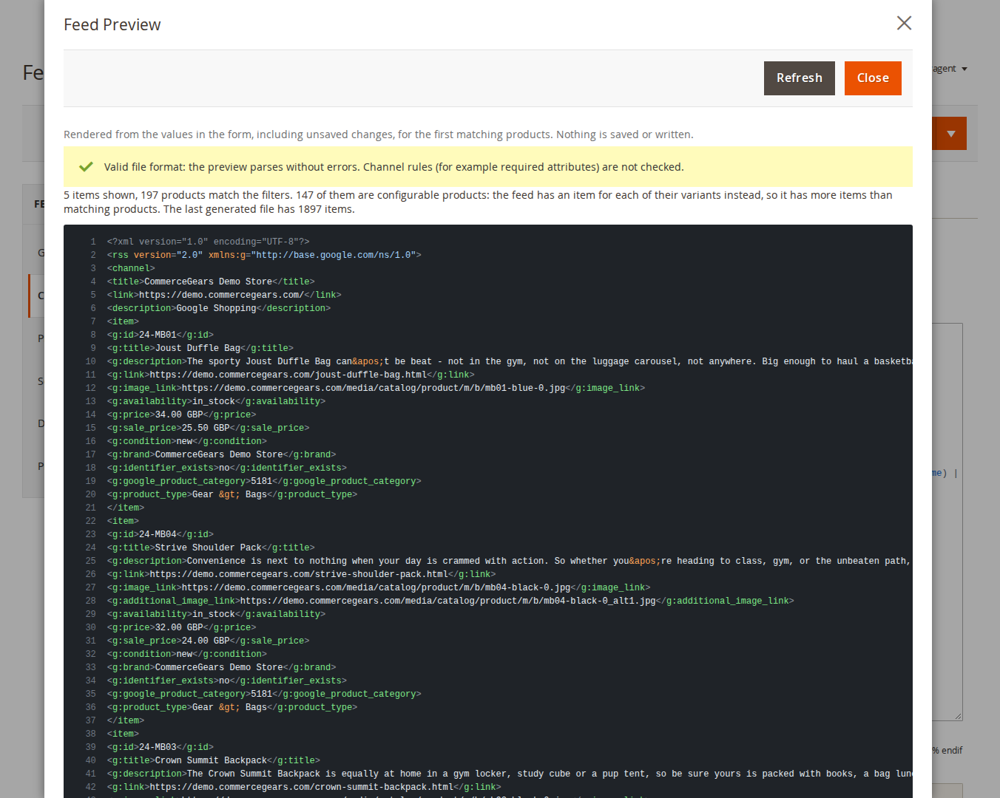
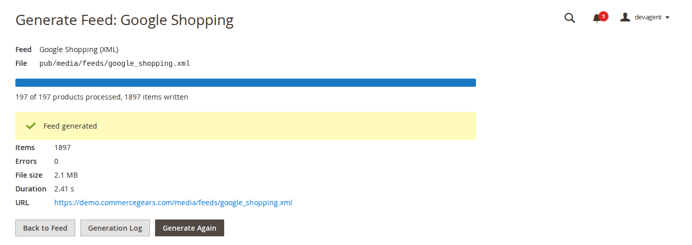
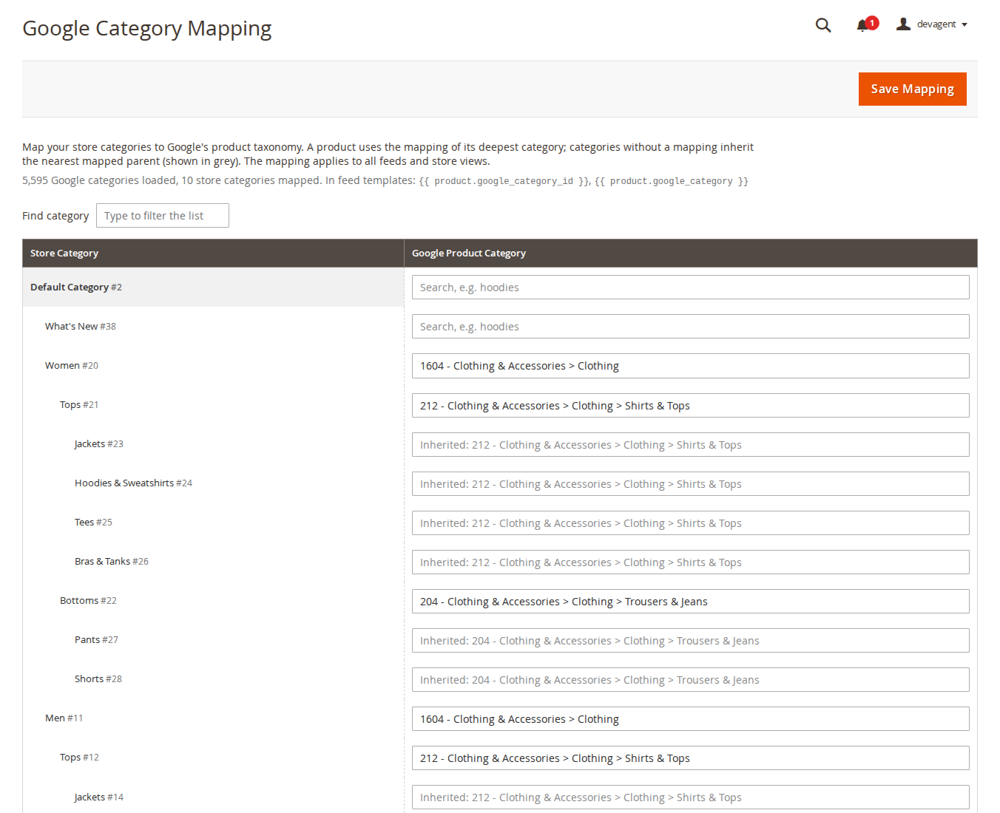

# Data Feed Manager for Magento 2: User Guide

Data Feed Manager exports your products as XML, JSON, CSV or delimited TXT feeds for Google Shopping, Meta
(Facebook and Instagram), Pinterest, Microsoft/Bing Shopping, price comparison sites and ERPs. Feeds are generated in
batches by cron, from the admin or on the command line, checked before they are published, and can be uploaded by
SFTP, FTP or FTPS.

- Admin demo: https://demo.commercegears.com/try-admin/data-feed-manager
- Sample feeds on the demo store: https://demo.commercegears.com/media/feeds/google_shopping.xml and
  https://demo.commercegears.com/media/feeds/meta_catalogue.csv
- Changelog: [CHANGELOG.md](../CHANGELOG.md) · Questions: [FAQ](faq.md)



## 1. Requirements

| | |
| --- | --- |
| Magento | Magento Open Source or Adobe Commerce 2.4.7 to 2.4.9 |
| PHP | 8.2 to 8.5 (with the FTP extension for FTP or FTPS upload) |
| Inventory | Default stock; with Multi-Source Inventory, stock values come from the default stock |
| Themes | Not involved: the module works in the admin, by cron and on the command line |
| Other | `commercegears/module-core` (installed automatically) |

## 2. Installation

Install with Composer. The access keys come from your account; see
https://commercegears.com/composer-access/ for the details.

```bash
composer config repositories.commercegears composer https://repo.commercegears.com
composer config --auth http-basic.repo.commercegears.com PUBLIC_KEY PRIVATE_KEY
composer require commercegears/module-data-feed-manager
bin/magento setup:upgrade
bin/magento setup:di:compile            # production mode only
bin/magento setup:static-content:deploy # production mode only
bin/magento cache:flush
```

The installation imports Google's product taxonomy in English (en-GB). Make sure Magento's cron is running
(`bin/magento cron:install`) for scheduled feeds. To update later, run
`composer update commercegears/module-data-feed-manager` and the same `bin/magento` commands.

## 3. Settings

**Stores > Configuration > CommerceGears > Data Feed Manager** (also under **CommerceGears > Data Feed Manager > Settings**).
Store view, currency and schedule are set per feed; these settings apply to all feeds.

| Setting | What it does |
| --- | --- |
| General > Enabled | When set to No, no feeds are generated (cron, admin or command line). Existing feed files stay in place. Default: Yes. |
| Generation > Batch Size | Products loaded at a time, 10 to 5000. Default: 250. Lower it if generation runs out of memory. |
| Generation > Preview Items | Items rendered by the feed preview, 1 to 20. Default: 5. |
| Generation > Keep Generation Log For (Days) | Older log entries are deleted daily, 0 to 3650. Default: 30; 0 keeps the log for ever. |
| Product Data > Brand Attribute | The product attribute read by `{{ product.brand }}`, which the Google Shopping (g:brand), Meta, Pinterest and Microsoft templates send as the brand. A variant without a value uses its parent's; the store name is used only when there is no brand at all. Default: Automatic (the attribute `brand` if your store has one, otherwise `manufacturer`). |

## 4. Creating a feed

Go to **CommerceGears > Data Feed Manager > Feeds** and open the **Add Feed** split button. Choose **From template:
Google Shopping**, Meta catalogue, Pinterest catalogue, Microsoft/Bing Shopping or generic JSON, or **Blank feed**.
The main part of the button opens a blank feed.
The feed form has tabs on the left.

### General

| Field | What it does |
| --- | --- |
| Enabled | Disabled feeds are not generated by cron. |
| Name | Your name for the feed. |
| Store View | Product values, prices, URLs and stock come from this store view and its website. |
| Format | XML, JSON, CSV or TXT (delimited). |
| File Name | For example `google_shopping_k3v9q2xa.xml`. New feeds get a random part so the URL cannot be guessed. The extension (.xml, .json, .csv, .txt or .tsv) must match the format. |
| Directory | Relative to the Magento root. Below `pub/media/` the file gets a public URL; below `var/` it stays private (use the upload). |
| Currency | Prices are converted from the base currency with the rates in **Stores > Currency Rates**. |

### Content: template (XML and JSON)



The editor highlights the template so the parts are easy to tell apart: template tags and keywords, variables,
filters, strings and comments, and the XML (or JSON) around them. Line numbers are on the left and the cursor's line
and column below the field. An unclosed `{{`, `{%` or `{#` is marked in red. **Tab** indents (several selected lines
at once), **Shift+Tab** outdents; to leave the field with the keyboard press **Esc**, then **Tab**. Undo (Ctrl+Z)
works as usual, and the template is saved exactly as typed.

```

<item>
  <g:id>{{ product.sku }}</g:id>
  <g:title>{{ product.name | strip_tags | clean | truncate(150, '') }}</g:title>
  <g:price>{{ product.regular_price_incl_tax | price }}</g:price>
  <g:sale_price>{{ product.final_price_incl_tax | price }}</g:sale_price>
</item>

```

- `{{ … }}` prints a value, escaped for XML or JSON automatically.
- ` … ` marks the repeated item (exactly one, at the top level). Everything
  before it is the header, everything after it the footer.
- ``, ``, ``, ``, `` and
  `{# comments #}`; `loop.index`, `loop.first` and `loop.last` inside loops.
- Operators: `and or not == != < > <= >= in ~ + - * /`, the fallback `a ?? b` and `a ? b : c`.
- Filters include strip_tags, truncate, upper, lower, capitalize, title, trim, clean, number_format, round, price,
  default, replace, regex_replace, prepend, append, join, split, first, last, slice, count, unique, date, html_decode,
  url_encode, json, cdata, raw and escape.

**Variables and Filters** below the editor lists every variable with a description: product attributes (store view
values and option labels, `product.raw.<code>` for the stored value), prices (`regular_price`, `final_price`,
`special_price`, `min_price`, `max_price`, each also `_incl_tax` and `_excl_tax`, `tier_prices`, `on_sale`), stock
(`qty`, `is_in_stock`, `is_salable`, `availability`), `url`, images (`image`, `images`, `all_images` and more),
categories (`category`, `category_path`, `google_category_id`, `google_category`), `brand`, `parent.*` and `item_group_id`
for variants, `variants` and `children`, reviews (`reviews_count`, `rating`), `store.*`, `feed.*` and `now`.

The language is a sandbox: it has no access to PHP, files or configuration. For safety, XML feeds may not contain
XHTML, SVG, MathML, XSLT or XLink content or an `xml-stylesheet` instruction.

### Content: columns (CSV and TXT)



Each column has a **Header**, a **Value** (the same template syntax, or static text such as `new`) and a **Default
(when empty)**. Drag the handle to reorder columns. Below the columns: **Delimiter** (comma, semicolon, tab, pipe),
**Enclosure** (double quote, single quote, none), **Encoding** (UTF-8, UTF-8 with BOM for Excel, ISO-8859-1,
Windows-1252), **Line Ending** (LF or CRLF) and **Header Row**.

### Product Filters



| Field | What it does |
| --- | --- |
| Enabled Products Only | Leave out disabled products. |
| In-Stock Products Only | Leave out products that are out of stock. Google, Meta and Pinterest accept out-of-stock items, so this is usually off. |
| Product Types, Attribute Sets, Visibility | None selected means all. |
| Configurable Products | Parents only, variants only (each variant with `item_group_id` = parent SKU, no parent row), or parents and variants. |
| Categories, Category Filter | Only products in these categories, or products not in these categories. Subcategories are included. |
| Attribute Conditions | Attribute, operator (= != > < >= <=, contains, does not contain, is one of, is not one of, is empty, is not empty) and value. All conditions must match. For dropdowns enter the option label (for example Red) or its ID; dates as YYYY-MM-DD. |
| Exclude SKUs | One per line or comma separated. |

### Schedule

**Generate**: Manual only (admin or CLI), Daily at set times (for example `03:00, 15:00`) or a Cron expression (for
example `0 */4 * * *`), in the store view's timezone. The form shows the next run.

### Delivery (FTP / SFTP)

**Upload After Generation** uploads the file after each generation; the local file is always written too. Fields:
**Protocol** (SFTP, FTP, FTPS with explicit TLS), **Host**, **Port** (empty = 22 for SFTP, 21 for FTP and FTPS),
**Username**, **Password** (stored encrypted), **Remote Directory** (must exist), **SFTP Host Key** and **Passive
Mode (FTP)**. **Test Connection** checks the settings in the form.

- SFTP host key check: the server's key fingerprint (`SHA256:…`) is saved on the first upload, or you enter it. If
  the server later presents another key, the upload stops before the password is sent. Clear the field when the
  server was really replaced.
- After changing the host or protocol, enter the password again; the saved password is not sent to another host.
- A failed upload marks the run as a warning; the local file is still updated.
- Tested status: FTP upload was tested against a local FTP server. SFTP has not yet been tested against a real SFTP
  server. FTPS does not verify the server's TLS certificate (a limit of PHP's FTP extension), so prefer SFTP.

### Preview



Click **Preview** in the page header (or **Preview Output** above the template or columns) at any time: a panel
shows the feed for the first matching products, rendered from the values in the form, including unsaved changes,
and validates it. The store view, product filters and attribute conditions of the feed apply. The output is
highlighted (XML, JSON, or CSV/TXT with the delimiters marked) and has line numbers. Nothing is saved or written.
The **Preview** tab of the form shows the same with **Preview First Items**.

- How many items: the Preview Items setting (default 5, at most 20). The summary also says how many products match
  the filters. Products are counted once: when configurable products are exported as their variants, the summary
  says how many of the matching products are configurable, and the feed has more items than matching products. For
  a saved feed it also gives the item count of the last generated file.
- "Valid file format" means the output parses (XML, JSON, CSV/TXT columns). It does not check a channel's own
  rules: for example Google assigns a category itself when `g:google_product_category` is missing, and a product
  without categories has no `product_type`.
- A template error names its line; **Show line N in the template** opens the Content tab with the cursor on it.
- Items that fail (for example invalid XML) are listed with the SKU and the line of the item's output; a
  validation error of the whole output marks that line in the output.
- When the template prints nothing for most products, the preview stops after reading 500 products (or about
  10 seconds) and says so.

### Saving

**Save** keeps you on the form; the split button also has **Save & Close** and **Save & Generate Now**. Invalid file
locations and template syntax errors are refused on save, and the entered values are kept.

## 5. Generating feeds

- **By cron:** feeds with a schedule are generated in the cron group `commercegears_datafeed`.
- **In the admin:** **Generate Now** (in the form or the grid's Select menu) runs batch by batch in the browser with a
  progress bar, then shows items, errors, file size, duration and the URL.
- **On the command line:** see section 9.



Each run writes to a temporary file. Items that fail their check are skipped and logged. The finished file is
validated (streamed XML parse, JSON decode) and only then replaces the old file, in one step. If the file is invalid,
it is not published and the previous file stays. Two runs of the same feed cannot overlap.

The grid shows each feed's file link, schedule, next run, last generated time, result, items and size, and has a
keyword search. Public feeds show their URL in the File column; feeds below `var/` show their location relative to
the Magento root. Mass actions: enable, disable and delete. Row actions: Edit, Generate Now, View Log, Duplicate and
Delete; Generate Now, Duplicate and Delete ask for confirmation first.

**CommerceGears > Data Feed Manager > Generation Log** lists every run: feed, start time, started by (cron, admin or CLI),
status, seconds, items, errors, file size and messages. A run that never finished (for example the server
restarted, or the browser tab was closed during Generate Now) is marked as an error, counted as one error, by the
daily log clean-up (03:17) once it is more than 75 minutes old.

## 6. Google category mapping



**CommerceGears > Data Feed Manager > Google Category Mapping** lists your store categories. Type in the field next to a
category (for example "hoodies") and pick a Google category. A product uses the mapping of its deepest category;
categories without a mapping inherit the nearest mapped parent (shown in grey). Use **Find category** to filter the
list and **Save Mapping** to save. In templates use `{{ product.google_category_id }}` or
`{{ product.google_category }}`. The mapping applies to all feeds and store views.

**Taxonomy Language:** download `taxonomy-with-ids.<locale>.txt` from Google (for example
`taxonomy-with-ids.de-DE.txt`) and import it at the bottom of the page or with `commercegears:feed:taxonomy-import`.
Category IDs are the same in every language, so existing mappings stay valid.

## 7. File locations and privacy

- Feeds can be written below `pub/` (public; below `pub/media/` the URL is the media URL) or below `var/` (private).
  `pub/static/`, `pub/errors/` and hidden folders are not allowed.
- File names may only contain letters, digits, `.`, `-` and `_`.
- Outside `pub/media/feeds/` a feed can only create a new file: a location where another file already exists (for
  example `pub/robots.txt`) is refused.
- Public files can be read by anyone who has the URL. Put feeds with private data (cost, stock levels) below `var/`
  and upload them by SFTP.

## 8. Permissions (ACL)

Under **System > Permissions > User Roles > Role Resources > CommerceGears > Data Feed Manager**:

| Resource | Allows |
| --- | --- |
| Manage Feeds | The feed grid and form. |
| Manage Feeds > Generate Feeds | Generate Now and Save & Generate Now. |
| Manage Feeds > Delete Feeds | Deleting feeds. |
| Google Category Mapping | The mapping page and taxonomy import. |
| Generation Log | The log. |
| Data Feed Manager Settings | The configuration section. |

## 9. Command line

```bash
bin/magento commercegears:feed:list                                   # feeds with schedule, last run, items, status and URL
bin/magento commercegears:feed:generate <id> [<id> ...]               # generate the given feeds
bin/magento commercegears:feed:generate --all                         # generate all enabled feeds
bin/magento commercegears:feed:preview <id> [--limit=3]               # print the first items
bin/magento commercegears:feed:taxonomy-import [path/to/taxonomy-with-ids.de-DE.txt]
```

## 10. Troubleshooting

| Problem | Solution |
| --- | --- |
| A scheduled feed is not generated | Check that Magento's cron runs, that the feed and **General > Enabled** are on, and the next run in the Schedule tab. |
| "The file was not published because it is invalid" | Open the Generation Log for the line and the reason, fix the template and use Preview. The previous file is still online. |
| Items are missing | Check the Product Filters and the Configurable Products mode, and the log for skipped items. |
| Prices are outdated | Feeds use the price index: reindex prices. |
| Upload fails | Use **Test Connection**. Check host, port, remote directory (it must exist) and, for SFTP, whether the host key changed. |
| Generation runs out of memory | Lower **Batch Size**. |

## 11. Limitations

- Prices are guest prices from the price index; tax uses the store's default tax destination.
- Attribute conditions apply to the selected products, not to variants added through the Configurable Products mode.
- The Google category mapping is global, not per store view or feed.
- CSV values are written as they are, without protection against spreadsheet formulas; do not open feeds built from
  untrusted text in a spreadsheet program.
- SFTP upload has not yet been tested against a real SFTP server; FTPS does not verify TLS certificates.

## 12. Uninstall

```bash
bin/magento module:disable CommerceGears_DataFeed
composer remove commercegears/module-data-feed-manager
bin/magento setup:upgrade
```

Feed files that were already generated stay where they are; delete them yourself if channels should no longer read
them.
